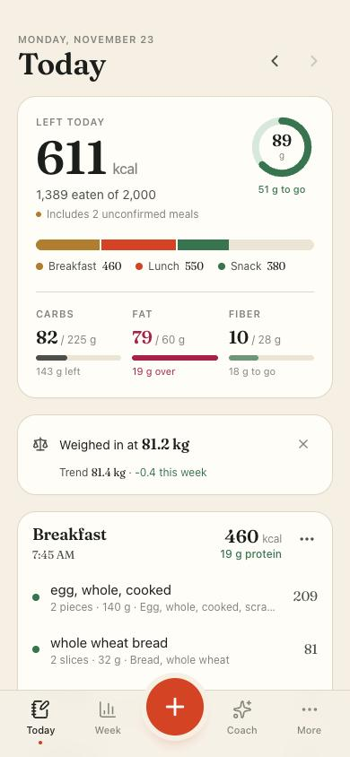
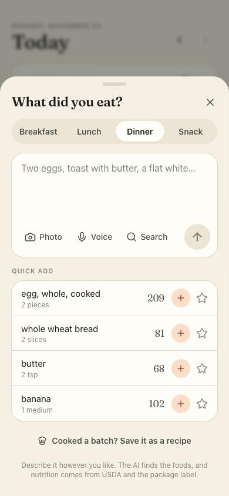
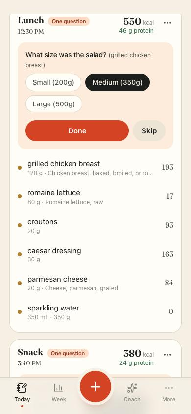
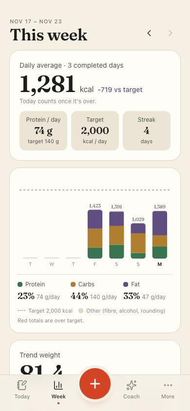
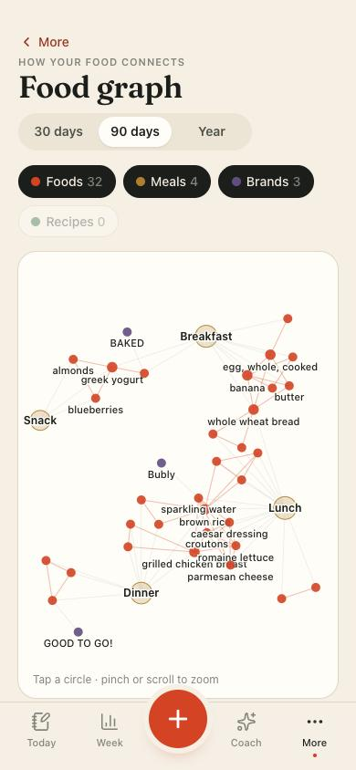
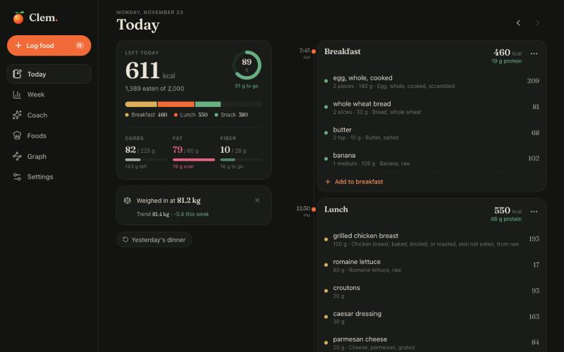
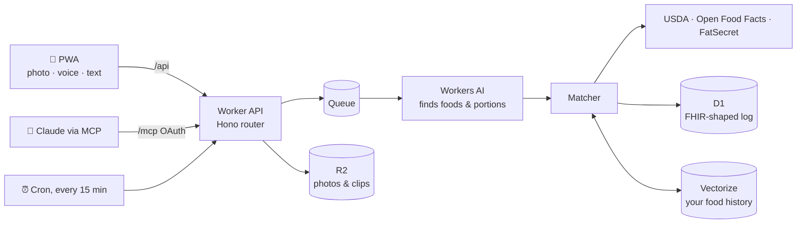

<div align="center">


# Clem

**Snap it, say it or type it. Clem works out what you ate, and the nutrition comes from real food databases.**

A personal nutrition tracker that installs on your phone and runs entirely on your own Cloudflare account.

[](https://github.com/awbauer/nutrition-app/actions/workflows/ci.yml)


[](LICENSE)

[](https://deploy.workers.cloudflare.com/?url=https://github.com/awbauer/nutrition-app)

<br />

&nbsp;
&nbsp;


</div>

## What it does

- 📸 **Log the way you'd tell a friend.** Take a photo of your plate, record a quick voice note, or type "two eggs, toast with butter and a banana". Clem breaks it into foods and portions.
- 🔎 **Real nutrition data.** The AI only identifies foods and amounts. Calories and nutrients always come from food databases: [USDA FoodData Central](https://fdc.nal.usda.gov/), [Open Food Facts](https://world.openfoodfacts.org/) (barcodes) and, optionally, [FatSecret](https://platform.fatsecret.com/) (restaurant chains). The model never makes up a number.
- 🙋 **Asks rather than guesses.** When a portion matters, Clem asks one quick question, such as "what size was the salad?", and counts its best guess until you answer.
- 🎯 **Targets that add up.** Set calories and protein, or start from your height, weight and goal. Fat, carbs and fiber fill in around the targets you set, and the day view shows progress on each.
- 📈 **Week, weight and trends.** Weekly macro split and averages, a smoothed weight trend, and a food graph that shows how your meals connect.
- 🧑‍🏫 **A nightly coach.** Each night a model reads the numbers from your log and writes a short report on what went well and what to try. It interprets your data; it doesn't invent it.
- 🔔 **Reminders and offline logging.** Meal reminders by push notification, and meals logged offline are queued and sent when you're back online.
- 🤖 **Works with Claude.** A built-in [MCP](https://modelcontextprotocol.io/) server with 28 tools lets Claude (or any MCP client) read your day, log meals and adjust targets for you.
- 🔒 **Yours alone.** It runs on your Cloudflare account behind Cloudflare Access. No third-party analytics, and the data model mirrors FHIR, so exports are standard.

<div align="center">
&nbsp;

<br /><br />

</div>

## Deploy your own

Clem is built to run as one person's private app on their own Cloudflare account. It uses Workers, D1, R2, KV, Queues, Vectorize and Workers AI. Light personal use fits within the free tiers of most of these. Workers AI and Vectorize bill past their free allowances; see [Cloudflare pricing](https://developers.cloudflare.com/workers/platform/pricing/).

### 1. Click the button

[](https://deploy.workers.cloudflare.com/?url=https://github.com/awbauer/nutrition-app)

This copies the repo into your GitHub account, creates the database, storage, queue and search index, and deploys. Every later push to your copy deploys automatically, with database migrations applied first.

The button asks for a few values:

| Value | What to enter |
| --- | --- |
| `USDA_API_KEY` | A free key from [api.data.gov](https://fdc.nal.usda.gov/api-key-signup). `DEMO_KEY` works for a quick try. |
| `AI_GATEWAY_ID` | `default` (created for you), or the name of an [AI Gateway](https://developers.cloudflare.com/ai-gateway/) you've made. |
| `ACCESS_TEAM_DOMAIN`, `ACCESS_AUD` | Enter `pending` for now; you'll set them in step 2. |

### 2. Lock it to you with Cloudflare Access

Until Access is set up, every API call answers **401**, so the app is never open to the internet.

1. In the dashboard, open your Worker → **Settings** → **Domains & Routes** → `workers.dev` → **Enable Cloudflare Access**, and allow only your own email.
2. Copy the application's **AUD tag** and your team domain (for example `myteam.cloudflareaccess.com`), then replace the placeholders:

   ```bash
   npx wrangler secret put ACCESS_TEAM_DOMAIN
   ```

   ```bash
   npx wrangler secret put ACCESS_AUD
   ```

### 3. Finish setup

- **Search your own food history by meaning** ("those chicken meatballs I like"). Add the index's user filter once:

  ```bash
  npx wrangler vectorize create-metadata-index nutrition-history --property-name=user_id --type=string
  ```

  If the button couldn't create the index, create it first with `npx wrangler vectorize create nutrition-history --dimensions=1024 --metric=cosine`. Without it, Clem falls back to word search.
- **Push reminders (optional).** Run `node scripts/vapid-keys.mjs`, then `wrangler secret put` each of `VAPID_PUBLIC_KEY`, `VAPID_PRIVATE_KEY` and `VAPID_SUBJECT` (a `mailto:` address).
- **Restaurant foods (optional).** Add `FATSECRET_CONSUMER_KEY` and `FATSECRET_CONSUMER_SECRET` from a [FatSecret Platform](https://platform.fatsecret.com/) account.
- **AI Gateway logs** include meal photos, so set the log retention you're comfortable with.

### 4. Install it on your phone

Open the site in Safari on iPhone → **Share** → **Add to Home Screen**. Open Clem from the Home Screen, then go to **Settings** → **Reminders** → **Turn on notifications**.

### Connect Claude (optional)

1. Access protects the whole Worker, so Claude's servers can't reach the connector endpoints. In Zero Trust, add a second, path-scoped Access application with a **Bypass** policy for these paths:
   - `/mcp`
   - `/oauth/token`
   - `/oauth/register`
   - `/.well-known/oauth-authorization-server`
   - `/.well-known/oauth-protected-resource/mcp`

   These paths check their own OAuth tokens. `/authorize`, the consent page, stays behind Access.
2. Add `https://<your-worker>.workers.dev/mcp` as a custom connector in Claude. You'll sign in through Access and approve the connection.

Claude can then use tools such as `log_meal`, `get_day`, `set_targets` and `get_coach_report`.

<details>
<summary><b>Deploying by hand instead</b></summary>

```bash
npx wrangler login
npx wrangler vectorize create nutrition-history --dimensions=1024 --metric=cosine
npx wrangler vectorize create-metadata-index nutrition-history --property-name=user_id --type=string
npm ci
npm run deploy        # builds, provisions D1/R2/KV/Queue, applies migrations, deploys
```

Then set the secrets from steps 1–3 with `npx wrangler secret put`. If you set `AI_GATEWAY_ID` to anything other than `default` in `wrangler.jsonc`, create that gateway first.

</details>

## How it works



1. You log a meal. The Worker stores any photo or audio in R2 and queues the job, so the app responds immediately.
2. Workers AI identifies the foods and portions and asks questions where the portion is unclear.
3. The **matcher** searches the food databases and your own history, ranks the candidates, and keeps the nutrients from the database entry it picks. Implausible data, such as per-serving numbers stored as per-100 g, is rejected.
4. Totals, targets, weekly views and the nightly coach all read from the same log in D1.

| Layer | Choice |
| --- | --- |
| Frontend | Vite, Preact and Tailwind v4, served as Worker static assets (one origin) |
| API | A Cloudflare Worker, with [Hono](https://hono.dev/) as its web framework for routing, plus an MCP server with OAuth 2.1 |
| Auth | Cloudflare Access; the Worker validates the JWT |
| Data | D1 (numbered migrations in `migrations/`); FHIR mapping in [docs/fhir-mapping.md](docs/fhir-mapping.md) |
| Media | R2 (private) |
| AI | Workers AI through AI Gateway; a Queue runs jobs in the background |
| Search | Vectorize over the foods you've eaten |
| Schedules | Cron Trigger every 15 minutes (reminders, nightly coach) |

## Development

```bash
npm ci
cp .dev.vars.example .dev.vars
printf 'DEV_AUTH=1\nDEV_USER_EMAIL=me@example.test\nAI_GATEWAY_ID=\n' >> .dev.vars   # skip Access locally
npm run db:migrate:local
npm run dev           # http://localhost:8787
```

`DEV_AUTH=1` skips Access, and only on `localhost`, so it can never open a deployed Worker. `npm run dev:web` runs Vite with hot reload and proxies `/api` to `wrangler dev`.

```bash
npm test              # Vitest inside workerd
npm run typecheck
npm run format        # CI runs format:check
```

```
src/worker/        Worker: index.ts (OAuth + MCP), app.ts (routes), lib/ (domain logic), routes/
web/               PWA: index.html, src/ (Preact), public/ (manifest, icons, service worker)
migrations/        D1 schema, applied in order
test/              Vitest running inside workerd (@cloudflare/vitest-plugin)
docs/              Spec, FHIR mapping, screenshots
```

Agents (and people) working in this repo should read [AGENTS.md](AGENTS.md) for the merge bar and house rules.

<details>
<summary><b>Tuning the food matcher</b></summary>

Every weight, threshold and word list the matcher uses lives in `src/worker/lib/match-config.ts`. Each AI-logged item records a matcher version, which is a hash of that config, so the version changes whenever a weight does. Bump `logic` there when scoring code changes in a way the numbers don't show.

Ranking is a pure function, `decide()` in `src/worker/lib/decide.ts`. `test/golden.test.ts` runs it over the cases in `test/fixtures/golden-matches.json`, each stored with the candidates the databases returned, so it runs offline. It fails if fewer cases are right than its baseline. After a tuning change, run `npx vitest run test/golden.test.ts` to print the hit rate and every miss.

To add cases from what you've logged locally:

```bash
# Items the AI logged in the local D1: ones you swapped become reviewed cases (the food you swapped to is the answer),
# the rest unreviewed. --refetch re-runs the USDA and FatSecret searches for full candidate lists (keys from .dev.vars).
npm run golden -- --db .wrangler/state/v3/d1/miniflare-D1DatabaseObject/<id>.sqlite --refetch
# or from an export: npx wrangler d1 export nutrition --local --output local.sql
npm run golden -- --db local.sql --refetch
# Hand-written cases (name, estimate, expected foods): add to test/fixtures/golden-queries.json, then
npm run golden -- --queries test/fixtures/golden-queries.json --refetch
```

Existing cases are kept; pass `--replace` to rebuild them. For each new `"status": "unreviewed"` case, set `expect` to the acceptable food names and `status` to `"reviewed"`. Only reviewed cases count toward the hit rate. The fixture holds food names, brands, public database ids and nutrients only. It contains no user or item ids, dates, meal text or custom foods.

</details>

<details>
<summary><b>How updates reach the installed app</b></summary>

`npm run deploy` builds, applies pending D1 migrations, then deploys the Worker. Each build is stamped with a version (git SHA plus build time), which is written to `/version.json` and into `sw.js`.

- A changed `sw.js` makes the browser install a new service worker, which precaches the new shell and deletes old caches.
- The app checks `/version.json` when it returns to the foreground and every 15 minutes. If the version changed, it reloads right away. If a sheet is open, a save is in flight or you're typing, it instead shows an "A new version is ready" banner and reloads at the next quiet moment.
- Meals waiting in the offline queue live in IndexedDB and survive the reload.
- Migrations run before the new Worker goes live, and old clients may still call the API for a few minutes. Keep schema changes additive: add columns or tables, and drop only in a later release.

The running version is shown at the bottom of Settings.

</details>

---

<sub>The original build spec is in [docs/spec.md](docs/spec.md). Work is tracked in [GitHub issues](https://github.com/awbauer/nutrition-app/issues). Screenshots show made-up demo data. [MIT licensed](LICENSE).</sub>
